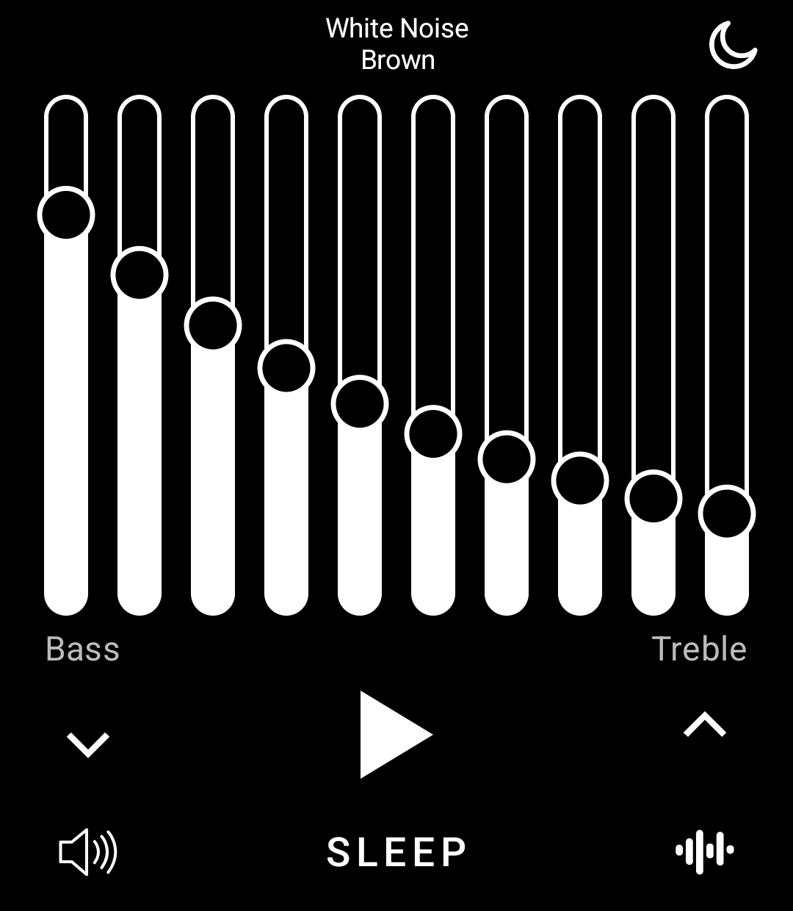
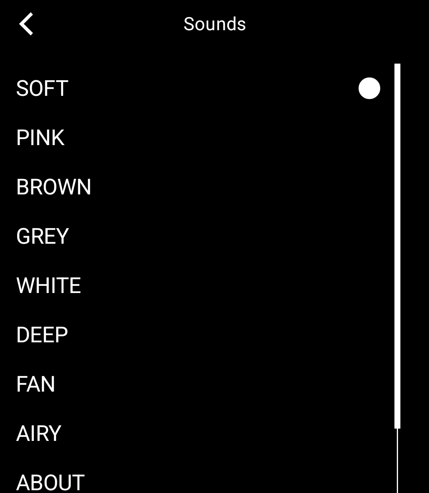
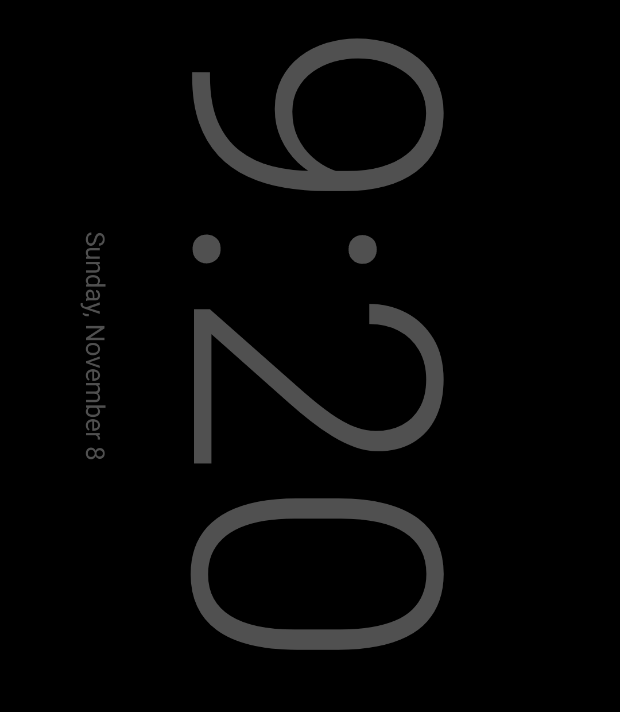

# White Noise

Noise for sleep, study and quiet, for the Light Phone III. Built with the [Light SDK](https://github.com/lightphone/light-sdk) by Slow Pixels.

<p>
  
  
  
</p>

- **Ten sliders**, one octave each. Tap to jump, drag across to draw a shape, or use two fingers to move them all.
- **Eight ready-made sounds:** Soft, Pink, Brown, Grey, White, Deep, Fan and Airy, and your own shape as Mine.
- **Animate** moves the sliders slowly by themselves: Zen, Drift, Waves or Breathe.
- **Sleep timer** from 15 minutes to 8 hours, with a one-minute fade at the end.
- **Night clock** shows the time on a dark screen while the sound plays. It stays on, has five levels of brightness, and lies sideways for a phone resting on its side (a tap on Turn sets it upright).

The noise is made live on the phone from a random number generator, so it never loops and never repeats.

## Privacy

White Noise works with no connection. It collects nothing, sends nothing and has no ads or tracking. Your sliders and choices stay in a small file in the tool's own storage. `lighttool.toml` asks for no permissions; the ones in the built app come from the SDK.

## How the sound keeps going

The SDK's detached player plays files, and a file would have to loop. So the player plays a queue of silence (`play/Holder.kt`), which gives the tool the foreground service, audio focus and lock screen controls. The noise itself comes from an `AudioTrack` (`engine/NoiseEngine.kt`) that follows the player (`play/NoiseHub.kt`).

Backing out of the tool stops the sound, because the player's connection ends with the screen. Going to the toolbox with the Menu button keeps it playing.

## Building

This is a fork of `light-sdk`, with the tool in `tool/`. Build it as any Light tool:

```bash
./gradlew :tool:installDebug
```

To run it on the LightOS emulator, see [the emulator guide](docs/system_app/README.md).

## Licence

MIT, as the SDK is. See [LICENSE](LICENSE) for the SDK and [LICENSE-WHITE-NOISE](LICENSE-WHITE-NOISE) for the code in `tool/`.
